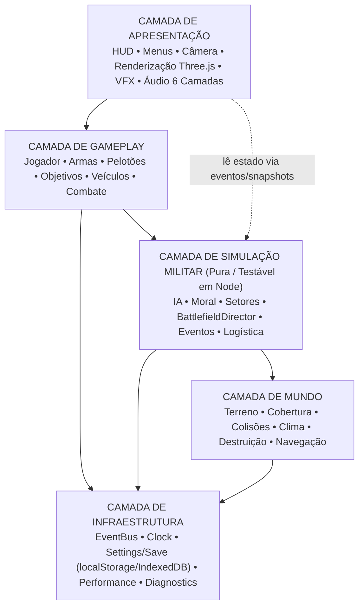
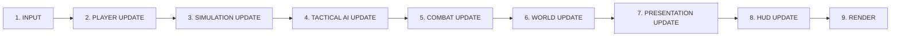

# 02 — Arquitetura Técnica Definitiva e Contratos entre Sistemas

> Baseado nas *Partes IV e VI (Seção 19)* da especificação definitiva. Define a organização em camadas, a árvore de diretórios alvo, os contratos TypeScript, o `GameLoop` escalonado, os algoritmos práticos de IA e os limites técnicos.

---

## 1. Estratégia Arquitetural e Regra de Ouro

O projeto atual concentra orquestração, loop, regras de fase, áudio, pós-processamento, spawn e persistência dentro de `src/engine/GameEngine.ts` (`1.892` linhas). O redesign substitui esse padrão por uma **arquitetura em 5 camadas com fronteiras rígidas**:



### Regra Arquitetural Principal
> **A lógica militar (`simulation/`, `ai/`, regras de `gameplay/` e `missions/`) NÃO deve depender da renderização do Three.js (`THREE.Scene`, `Mesh`, `InstancedMesh`).**
> Decisões táticas produzem intenções e estados em domínio puro; a camada `presentation/` observa eventos/snapshots e renderiza o resultado.

---

## 2. Estrutura Definitiva de Diretórios (`src/`)

*(Destino arquitetural completo; os módulos devem ser criados incrementalmente conforme cada marco `M0`–`M7`.)*

```text
src/
├── main.ts
│
├── core/
│   ├── GameApplication.ts      # Composição da aplicação e ciclo de vida
│   ├── GameLoop.ts             # Loop em 9 estágios + delta limitado
│   ├── GameClock.ts            # Tempo real, tempo simulado e pausa
│   ├── EventBus.ts             # Pub/sub tipado desacoplado
│   ├── ServiceContainer.ts     # Injeção leve de dependências entre camadas
│   ├── StateMachine.ts         # Utilitário genérico de máquina de estados
│   └── GameConfig.ts           # Constantes de simulação e presets gráficos
│
├── simulation/
│   ├── SimulationWorld.ts      # Estado autoritativo das entidades e setores
│   ├── SimulationScheduler.ts  # Escalonamento adaptativo por frequência (Hz)
│   ├── BattlefieldState.ts     # Snapshot serializável da batalha e campanha
│   ├── BattlefieldDirector.ts  # Coordenação de setores, frentes e reservas
│   ├── CombatDirector.ts       # Controle de ritmo e pressão tática
│   ├── BattlefieldEventSystem.ts
│   ├── SectorSystem.ts
│   ├── ReinforcementSystem.ts
│   ├── LogisticsSystem.ts
│   └── DistantBattleSimulator.ts
│
├── gameplay/
│   ├── player/     (PlayerController, PlayerMovement, PlayerCombat, PlayerHealth, PlayerPerception)
│   ├── combat/     (WeaponSystem, ProjectileSystem, DamageSystem, SuppressionSystem, ExplosionSystem, BallisticsSystem)
│   ├── squads/     (SquadSystem, SquadAI, SquadCommandSystem, SquadFormation, SquadMorale, SquadCommunication)
│   ├── soldiers/   (SoldierSystem, SoldierAI, SoldierMovement, SoldierPerception, SoldierAnimation, SoldierProfile)
│   ├── vehicles/   (VehicleSystem, TankSystem, VehicleDamage, VehicleAI)
│   └── objectives/ (ObjectiveSystem, ObjectiveEvaluator, ObjectiveTypes)
│
├── ai/
│   ├── TacticalDecisionEngine.ts
│   ├── BehaviorTree.ts
│   ├── PerceptionEngine.ts
│   ├── TacticalPlanner.ts
│   ├── Pathfinding.ts
│   ├── CoverEvaluator.ts
│   └── DoctrineProfiles.ts
│
├── world/
│   ├── WorldBuilder.ts
│   ├── TerrainSystem.ts
│   ├── EnvironmentSystem.ts
│   ├── CoverSystem.ts
│   ├── CollisionSystem.ts
│   ├── DestructionSystem.ts
│   ├── WeatherSystem.ts
│   └── WorldNavigation.ts
│
├── missions/
│   ├── CampaignManager.ts
│   ├── MissionManager.ts
│   ├── MissionLoader.ts
│   ├── MissionData.ts
│   ├── MissionDirector.ts
│   ├── MissionEvents.ts
│   └── MissionResults.ts
│
├── presentation/
│   ├── renderer/   (RendererManager, SceneManager, CameraManager, LightingManager, PostProcessing)
│   ├── effects/    (VFXSystem, ParticleManager, DecalSystem)
│   ├── audio/      (AudioEngine, SpatialAudio, RadioAudio, DynamicSoundscape)
│   └── animation/  (AnimationManager, AnimationController)
│
├── ui/
│   ├── UIManager.ts
│   ├── HUDManager.ts
│   ├── SquadCommandUI.ts
│   ├── RadioUI.ts
│   ├── BriefingUI.ts
│   ├── PauseUI.ts
│   └── styles.css
│
├── data/
│   ├── weapons/
│   ├── soldiers/
│   ├── squads/
│   ├── vehicles/
│   ├── missions/
│   ├── environments/
│   └── events/
│
└── infrastructure/
    ├── SaveManager.ts
    ├── SettingsManager.ts
    ├── AssetManager.ts
    ├── PerformanceManager.ts
    └── Diagnostics.ts
```

---

## 3. Contratos TypeScript Canônicos

Os tipos abaixo definem a espinha dorsal sem dependências circulares (usando `Vec3` plano `{ x: number; y: number; z: number }` na simulação em vez de depender diretamente de `THREE.Vector3` quando conveniente):

### 3.1. Perfil do Soldado, Comandos e Estados

```typescript
export interface Vec3 {
  x: number;
  y: number;
  z: number;
}

export interface SoldierProfile {
  id: string;
  role: SoldierRole;
  health: number;
  morale: number;
  suppression: number;
  fatigue: number;
  ammunition: number;
  alive: boolean;
  wounded: boolean;
  experience: number;
}

export type SquadCommandType =
  | 'advance'
  | 'hold'
  | 'flank'
  | 'regroup'
  | 'focus_target'
  | 'attack_vehicle';

export interface SquadCommand {
  squadId: string;
  type: SquadCommandType;
  targetPosition?: Vec3;
  targetEntityId?: string;
  issuedAt: number;
}

export type SquadState =
  | 'idle'
  | 'moving'
  | 'engaging'
  | 'suppressed'
  | 'reorganizing'
  | 'retreating'
  | 'defending'
  | 'disabled';

export type SoldierState =
  | 'idle'
  | 'patrolling'
  | 'moving'
  | 'seeking_cover'
  | 'aiming'
  | 'firing'
  | 'reloading'
  | 'suppressed'
  | 'wounded'
  | 'incapacitated'
  | 'dead';
```

### 3.2. Combate, Percepção, Setores e Missão Orientada a Dados

```typescript
export interface DamageContext {
  sourceId: string;
  targetId: string;
  damageType: DamageType;
  impactPosition: Vec3;
  hitZone?: HitZone;
  distance: number;
  material?: MaterialType;
}

export interface PerceivedEntity {
  entityId: string;
  lastKnownPosition: Vec3;
  confidence: number; // 0..1
  threatLevel: number;
  lastSeenAt: number;
  source: 'visual' | 'audio' | 'radio';
}

export interface BattlefieldSector {
  id: string;
  owner: Faction;
  controlProgress: number; // -100..+100 ou 0..1
  strategicValue: number;
  threatLevel: number;
  activeSquads: string[];
  reinforcementPoints: number;
  contested: boolean;
}

export interface MissionDefinition {
  id: string;
  title: string;
  description: string;
  mapId: string;
  environment: {
    weather: string;
    timeOfDay: string;
    atmosphere: string;
  };
  playerSquadId: string;
  objectives: ObjectiveDefinition[];
  sectors: SectorDefinition[];
  initialEvents: BattlefieldEventDefinition[];
  reinforcementRules: ReinforcementRule[];
  victoryConditions: MissionCondition[];
  failureConditions: MissionCondition[];
}
```

### 3.3. Eventos de Domínio (`EventBus`)

```typescript
export type GameEvent =
  | { type: 'squad.command.issued'; payload: SquadCommand }
  | { type: 'soldier.wounded'; payload: { soldierId: string } }
  | { type: 'sector.captured'; payload: { sectorId: string; faction: string } }
  | { type: 'vehicle.disabled'; payload: { vehicleId: string } }
  | { type: 'reinforcement.requested'; payload: { sectorId: string; faction: string } };
```

---

## 4. `GameLoop` e Escalonamento por Frequência (`SimulationScheduler`)

### 4.1. Pipeline Determinístico por Quadro



### 4.2. Frequências Iniciais do `SimulationScheduler`

A simulação completa não deve rodar integralmente a 60 Hz. O escalonador deve ser **adaptativo** conforme carga do dispositivo:

| Processo | Frequência Alvo | Observação |
|---|---|---|
| Renderização (`RENDER`) | Até 60 FPS | Limitado por dispositivo/VSync |
| Movimento e câmera do jogador | A cada frame | Máxima responsividade |
| Combate próximo | 20–60 Hz | Projéteis, colisões locais e detecção |
| IA individual próxima (LOD completo) | 5–15 Hz | Alternância de slots por frame |
| Decisões de pelotão (`SquadAI`) | 2–4 Hz | Reavaliação de cobertura e ordens |
| Estratégia geral (`BattlefieldDirector`) | 0,5–1 Hz | Setores, reservas e eventos |
| Simulação distante (`DistantBattleSimulator`) | 0,2–0,5 Hz | Confrontos abstratos fora do campo visual |

---

## 5. Inteligência Artificial Executável

1. **Sistema de Percepção (`PerceptionEngine`):** armazena `PerceivedEntity` com confiança temporal decadente e compartilhamento por rádio dentro do pelotão. Estados por alvo/unidade: `unaware → suspicious → investigating → detected → engaging → lost_contact`.
2. **Avaliação de Cobertura (`CoverEvaluator`):** pontua candidatos considerando proteção oferecida ($P$), vantagem visual ($V$), adequação da distância ($D$) e segurança da rota ($R$):
   $$\text{Score} = w_p P + w_v V + w_d D + w_r R$$
3. **Planejamento de Flanqueamento (`TacticalPlanner`):** calcula rotas laterais avaliando posição conhecida do inimigo, cobertura disponível, obstáculos, transitabilidade, distância, unidades próximas e risco de exposição.
4. **Moral (`SquadMorale`):** variação progressiva (sem saltos instantâneos de 100 para 0 por um evento isolado):
   $$M = \text{clamp}(M_0 - B - S - L - I + A,\; 0,\; 100)$$
   onde $M_0$ = moral inicial, $B$ = impacto das baixas, $S$ = supressão, $L$ = perda do líder, $I$ = isolamento e $A$ = apoio recebido.
5. **Pathfinding (`WorldNavigation`):** regiões/navmesh para rotas principais + grade espacial para consulta rápida + waypoints táticos de cobertura + replanejamento automático quando estruturas são destruídas.

---

## 6. Performance, LOD em 3 Níveis, Persistência e Política de Assets

### 6.1. LOD de Simulação Contínua
- **LOD Estratégico (distante):** simulação abstrata de confrontos e controle territorial sem instanciar soldados individuais.
- **LOD Tático (intermediário):** soldados representados visualmente com IA simplificada e menor taxa de atualização.
- **LOD Completo (próximo):** IA individual completa, animações, percepção, colisões e reações de combate.
*Transição contínua:* ao cruzar faixas de distância, o estado lógico (`SoldierProfile`, munição, moral, objetivo) é preservado.

### 6.2. Metas de Desempenho
- Desktop intermediário: **60 FPS** (`<= 16,7 ms/frame`).
- Desktop de entrada: **30–45 FPS**.
- Mobile compatível: **30 FPS** (`<= 33,3 ms/frame`).
- Alocação de memória por frame minimizada; **a meta antiga de 650 soldados simultâneos não é obrigatória** — o teto será calibrado pelo orçamento real em hardware.

### 6.3. Persistência Híbrida e Ferramental
- **`localStorage`:** configurações leves (volume, sensibilidade, qualidade gráfica, controles touch).
- **`IndexedDB`:** desbloqueios, progresso da campanha, estado dos pelotões (`SoldierProfile`), resultados de operações e estatísticas.
- **Stack recomendada no redesign:** TypeScript `strict` (já ativo em `tsconfig.json`), Vite, Three.js, ESLint, Vitest e sistema de física/colisão próprio inicialmente.

### 6.4. Política Híbrida de Assets
- Manter geração **procedural** para terrenos, trincheiras, clima, partículas, fumaça e efeitos de combate.
- Evoluir gradualmente para abordagem **híbrida** com biblioteca controlada (própria/licenciada) de modelos 3D (personagens e veículos), animações, texturas de terreno/estruturas e sons gravados (armas, motores, vozes e explosões) integrados ao WebAudio para espaciais e filtros.
